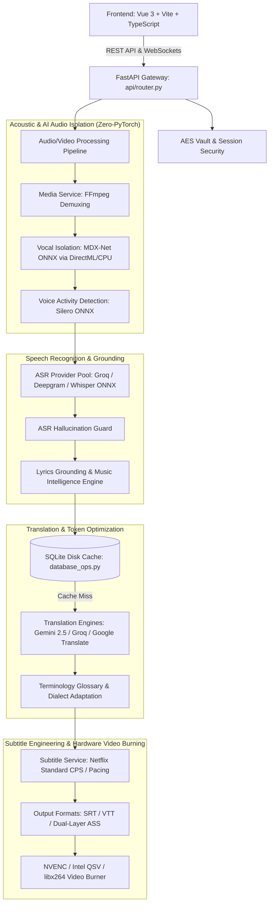
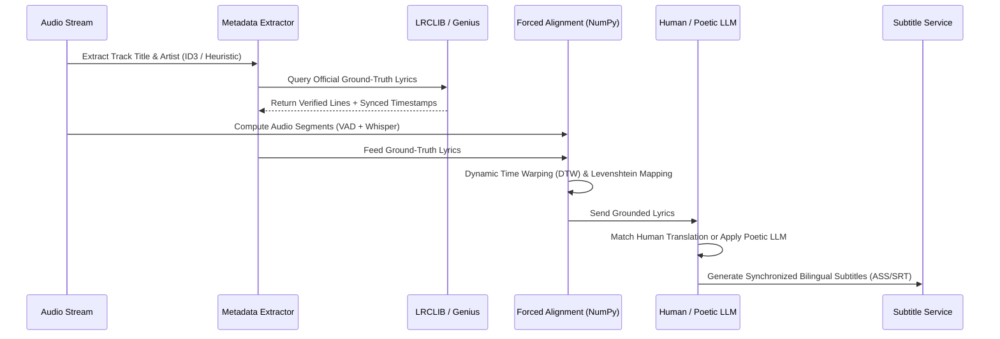

# SIGMA_ASR_VTT - Master System Architecture & AI Agent Blueprint

**المطور والمساهم الأساسي:** أصيل السويدي  
**System Status:** Production Hybrid (FastAPI + ONNX Runtime + Vue 3 / Vite)  
**Strict Invariants:** Zero-PyTorch Policy | English Numerals Only | Token-Optimized Caching  

---

## 1. High-Level Architecture Overview

SIGMA_ASR_VTT is an enterprise-grade audio/video processing and subtitle translation engine engineered for broadcast-level precision, sub-second latency, and zero token burn on repeated operations.

---

## 2. Fundamental Architectural Invariants

### 🚫 A. Zero-PyTorch Tolerance Policy (Strict & Inviolable)
- **Rule:** The codebase **strictly prohibits** `torch`, `torchaudio`, or `torchvision`.
- **Enforcement:** Automated tests (`backend/tests/test_master_matrix.py::test_sc08_zero_pytorch_strict_audit`) scan 100% of Python source files. Any PR or commit containing `import torch` will fail CI immediately.
- **Runtime Standard:**
  - Neural inference is executed exclusively via **ONNX Runtime** (`onnxruntime` or `onnxruntime-directml`).
  - Signal processing and numerical alignments are implemented via **NumPy** and pure Python algorithms.
  - Media extraction, audio resampling (16kHz mono), and video encoding are handled via native **FFmpeg** binaries.

### 🔢 B. English Numerals Standard (English Numerals Only)
- All numbers across UI, API responses, subtitles, database records, and logs must strictly use standard English digits (`0, 1, 2, 3, 4, 5, 6, 7, 8, 9`).
- Eastern Arabic digits (`٠, ١, ٢, ٣...`) are forbidden and must be transformed immediately if encountered.

### 🛡️ C. Token Conservation & High-Speed Disk Caching
- All LLM-translated phrases are hashed in a case-insensitive, trimmed format (`_make_cache_key`) and stored in SQLite (`app_data.db`).
- Repeated song verses, common dialogues, and chorus lines achieve **0 Token Burn** and 0ms latency.

---

## 3. Directory Taxonomy & Component Map

| Directory / File | Component Role | Technical Description |
| :--- | :--- | :--- |
| `backend/app/main.py` | Application Entrypoint | Bootstraps FastAPI, initializes SQLite schemas, mounts CORS, and registers routers. |
| `backend/app/api/router.py` | API Gateway | Exposes REST endpoints for media upload, transcription, translation, and export. |
| `backend/app/api/websocket.py` | Real-time Streaming | Broadcasts progress events, step completions, and metrics to UI over WebSocket. |
| `backend/app/core/config.py` | Configuration Manager | Pydantic-based settings, directory paths (`temp/`, `outputs/`, `models/`), and env configs. |
| `backend/app/core/models.py` | Data Contracts | Pydantic domain models: `SubtitleItem`, `APIKeyConfig`, `JobRequest`, `JobProgress`. |
| `backend/app/core/security.py` | Cryptographic Vault | Deterministic AES-GCM encryption for API keys with machine-safe vault fallback. |
| `backend/app/core/exceptions.py`| Domain Errors | Standardized hierarchy: `FileProcessingError`, `RateLimitError`, `ValidationError`. |
| `backend/app/services/asr_service.py` | Speech Recognition | Coordinates cloud/local ASR providers and runs `ASRHallucinationGuard`. |
| `backend/app/services/vocal_isolation_service.py` | Acoustic Separation | MDX-Net ONNX runner with dynamic model tiers (Light, Balanced, Studio) via DirectML. |
| `backend/app/services/vad_service.py` | Voice Activity Detection | Silero VAD ONNX model for high-precision speech segment boundary detection. |
| `backend/app/services/lyrics_grounding_service.py` | Music Grounding | Music Intelligence: extracts metadata, queries LRCLIB/Genius, and runs pure-NumPy Forced Alignment. |
| `backend/app/services/translation_service.py` | Linguistic Engine | Multi-engine translation coordinator with context windowing and glossary injection. |
| `backend/app/services/subtitle_service.py` | Subtitle Staging | Enforces Netflix reading standards (CPS), duration clamping, and exports SRT/VTT/ASS. |
| `backend/app/services/media_service.py` | Media Processor | FFmpeg probe, 16kHz audio extraction, and NVENC/QSV/CPU subtitle burning. |
| `backend/app/infrastructure/database_ops.py` | Persistence & Cache | SQLite CRUD for API keys, user profiles, and persistent token caching. |
| `backend/app/infrastructure/process_manager.py` | Process Supervisor | Asynchronous subprocess executor and magic-byte file signature validator. |
| `backend/tests/` | Master Test Suite | Comprehensive unit, security, acoustic, and integration tests (100% Green). |
| `frontend/src/` | Visual Workspace | Modern Vue 3 + TypeScript client for real-time monitoring and subtitle editing. |

---

## 4. Music Intelligence & Lyrics Grounding Pipeline

When audio contains songs or vocal performances, acoustic transcription alone is prone to vibrato phonetic drift (e.g. Turkish `Çağırsaydın` -> `Çalırsaydın`, `Aramam` -> `Araba`). The **Lyrics Grounding Service** resolves this via a 4-step pipeline:

1. **Track Metadata Detection:** Extracts artist/title from file metadata or filename heuristics (e.g. `Artist - Title.mp4`).
2. **Ground-Truth Lyric Fetching:** Queries open-access synchronized lyric repositories (LRCLIB, Genius) and local cache.
3. **Pure-Python Forced Alignment:** Uses Dynamic Time Warping (DTW) and Levenshtein distance on character n-grams to align verified lyric lines to exact acoustic speech boundaries without any PyTorch dependencies.
4. **Artistic Poetic Translation:** Prioritizes human crowdsourced translations; falls back to LLM with poetic song translation prompts, guaranteeing emotional resonance (e.g. "لن أبحث" instead of literal colloquialisms).

---

## 5. Coding Standards & AI Agent Invariants

1. **Surgical Edits:** Always use `replace_file_content` targeting small, exact blocks (<40 lines). Never rewrite entire files unnecessarily.
2. **Test First Verification:** After modifying any logic, run `pytest backend/tests/` to guarantee zero regressions across the 22+ test matrix.
3. **No Polling Loops:** Always adopt Event-Driven Architecture (`event -> process -> state update -> exit`). Never introduce busy-wait timers.
4. **Clean Logging:** Log all operations with sanitized messages. Never expose raw API keys or personal identifiers in log outputs.
